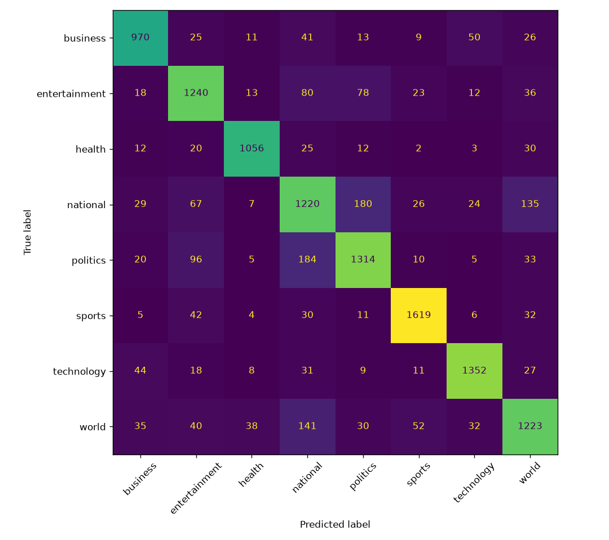

# Bhasha Classifier

This is my NLP capstone project (Project 11, Multilingual Text Classification). It takes a piece of text written in an Indian language and predicts which category it belongs to.

## Why we made this
Most text classifiers are built for English only. I wanted something that works on Hindi, Bengali, Tamil and other languages too, so I used character n-grams instead of word-level rules. This way the model does not need a separate tokenizer for every language.

## Dataset
- Source: [L3Cube + any other source you used]
- Languages: Bengali, English, Hindi, Tamil
- Categories: national, sports, technology, world, entertainment, politics, health, business
- Total rows in dataset: 60,000
- Train/test split: 80/20, stratified on the label

I removed empty rows and duplicates, and cleaned the text in `utils.py` without removing language-specific characters.

## What I did
1. Collected and merged the data (`build_dataset.py`)
2. Cleaned the text (`utils.py`)
3. Looked at label counts, language counts and text length (`eda.py`)
4. Converted text to TF-IDF features using character n-grams (`char_wb`)
5. Trained and compared a few models (`train.py`)
6. Checked results overall and for each language
7. Built a Streamlit app (`app.py`)

## Models and results

| Model | Accuracy | Precision | Recall | F1 |
|-------|----------|-----------|--------|----|
| BoW + Naive Bayes | 0.7468 | 0.7684 | 0.7468 | 0.7470 |
| TF-IDF + Logistic Regression | 0.8235 | 0.8260 | 0.8235 | 0.8245 |
| TF-IDF + Linear SVM | 0.8328 | 0.8337 | 0.8328 | 0.8332 |

Best model: TF-IDF + Linear SVM (accuracy 0.8328, F1 0.8332). The full tables are in `models/model_comparison.csv` and `models/per_language_metrics.csv`.

## Screenshots
EDA plots, the confusion matrix and the app are in the `screenshots` folder.




## How to run
```
git clone https://github.com/Shwetajha-206/bhasha-classifier.git
cd bhasha-classifier
pip install -r requirements.txt
python train.py
streamlit run app.py
```
Then open http://localhost:8501, paste some text, and click Classify Text.

## Limitations
- Very short text is harder to classify.
- Some languages have less data than others, so their scores are lower.
- Mixed-language text (like Hinglish) can give wrong results.

## Future work
Try multilingual transformer models like XLM-R or IndicBERT, and add more languages.

## Author
Shweta Jha
